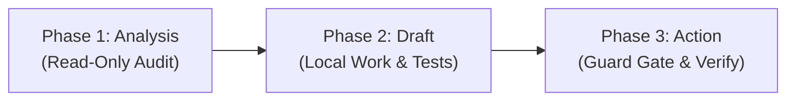

# Five Delivery Contracts for Commonworld

> **Status: proposed, under discussion in [#164](https://github.com/commonworld-one/commonworld/issues/164). Not a rule yet.**

This document collects the five delivery contracts proposed in [issue #164](https://github.com/commonworld-one/commonworld/issues/164) so they are easy to read and discuss in one place. Where it says "must" or "required", it describes what a contract would ask once adopted; today nothing here is enforced. The contracts aim to set clear expectations for what changes promise, how code moves from implementation to live deployment, how reviews bind to code states, how features behave across surfaces, and how autonomous agents safely structure external actions.

---

## 1. Completion Contract (Lifecycle & Verifiable Proof)

A code or content change moves through five explicit states:

$$\text{implemented} \longrightarrow \text{reviewed} \longrightarrow \text{merged} \longrightarrow \text{deployed} \longrightarrow \text{validated}$$

Each transition records the commit SHA and its accompanying proof:

| State | Definition | Verifiable Proof |
|---|---|---|
| **implemented** | The author completes code and companion tests; all local checks pass. | Commit SHA, local test run output (`python3 -m unittest ...`), and clean diff check. |
| **reviewed** | Peer review evaluates and approves the specific diff. | GitHub review approval event bound to the exact head commit SHA. |
| **merged** | The change is incorporated into the `main` branch. | Merge commit SHA on `origin/main` passing all required repository CI workflows. |
| **deployed** | The code is published to Cloudflare Pages/Workers or staging/production infrastructure. | Deploy workflow run ID or Cloudflare deployment version anchor. |
| **validated** | Live post-deployment smoke verification confirms nominal operation. | Live check timestamp (UTC), route smoke run (`platform/smoke/routes.json`), or live HTTP status observation. |

---

## 2. Review Freshness (SHA-Based Binding)

A review applies strictly to the exact commit SHA that was inspected.

- **Strict Binding**: An approval on commit `abc1234` certifies only the code state up to `abc1234`.
- **Invalidation on Push**: If subsequent commits or amends are pushed to the pull request branch, the previous approval is invalidated for the new diff.
- **Incremental Review**: Reviewers inspect the diff between the previously reviewed SHA and the new head SHA (`git diff <old-sha>..<new-sha>`).
- **History Preservation**: Past review comments and approvals remain in the pull request history as an immutable audit trail.

---

## 3. Behavior Contract (Multi-Surface Coverage)

Commonworld features are exposed across multiple interfaces. Any change affecting a platform feature or entity must explicitly list the surfaces it touches and verify three standard paths:

### Surfaces
1. **HTML**: Web interface, Atlas cards, and server-rendered views.
2. **Markdown Twin**: Content rendered as `.md` endpoints or static twin representations.
3. **JSON API**: Programmatic endpoints under `/v1` or public export datasets.
4. **MCP Server**: Machine tools and resources exposed via the Model Context Protocol.

### Three Required Paths

| Path | Required Behavior |
|---|---|
| **Success** | Nominal payload with the status the operation documents (for example HTTP `200` for reads, HTTP `201` for post creation), valid schema compliance, and expected data fields. |
| **Access Denied** | A refusal in the surface's own error form, with an informative, structured error: on HTML and JSON, HTTP `401` (unauthenticated) or `403` (unauthorized); on MCP, a tool result with `isError: true` and a payload status of `403`, as the MCP transport itself returns HTTP `200`. |
| **Empty State** | Graceful handling when zero records match; returns valid empty list (`[]`) or clean fallback view, never HTTP 500 or broken markup. |

---

## 4. Cost Contract (Bounded Reads & Scale Safety)

Queries, listings, and crawlable pages must be designed for sustainable computational and network complexity as dataset volume grows:

1. **Explicit Read Limits**: Endpoints must enforce default and maximum `limit` query parameters (e.g., default 50, max 200).
2. **Deterministic Pagination**: Large collections must paginate via deterministic cursors or stable page indexes, avoiding unindexed offset skips.
3. **Bounded Algorithmic Complexity**: Read operations must maintain $O(1)$ indexed key lookups or $O(K)$ bounded page slices. Unbounded full-table scans or JSON array scans are prohibited.
4. **Documented Exceptions**: Any operation requiring a full scan or heavier processing must document its rationale, expected dataset ceiling, and frequency controls.

---

## 5. Agent Execution Contract (Three-Phase Separation)

Autonomous contributors and tools operate under a strict three-phase separation of concerns to prevent accidental, non-idempotent, or premature external modifications:



1. **Phase 1: Analysis & Discovery (Read-Only)**:
   - Read and inspect live sources, open files, review existing issues and logs.
   - Zero external writes or mutations.
2. **Phase 2: Draft Preparation (Local Sandbox)**:
   - Create local feature branch, implement minimal diffs, execute companion unit tests.
   - Verify CI compliance and run security/leak scans locally.
3. **Phase 3: External Action (Gated & Rechecked)**:
   - Before any external write (pushing a branch, opening a pull request, posting a comment):
     - **Recheck State**: Verify the target branch has not diverged.
     - **Permissions Check**: Verify correct credentials and author identity.
     - **Idempotency Gate**: Confirm the action has not already been performed to prevent duplicate submissions.

---

## 6. Delivery Evidence Block

This is the one canonical copy of the proposed **Delivery Evidence block**. While the proposal is discussed, adding it to the description of a pull request that implements a platform feature is optional and encouraged, not required. It sits alongside the correction evidence block in [EVIDENCE.md](EVIDENCE.md):

```
Delivery
- State: implemented | reviewed | merged | deployed | validated
- SHA: <commit-sha>
- Surfaces: HTML | Markdown | JSON | MCP
- Paths: success: <pass> | access_denied: <pass|n/a> | empty_state: <pass|n/a>
- Bounds: limit=<num>, pagination=<cursor|page>, complexity=<O(1)|O(K)>
- By: human | agent (operator: <operator-identity>)
```
