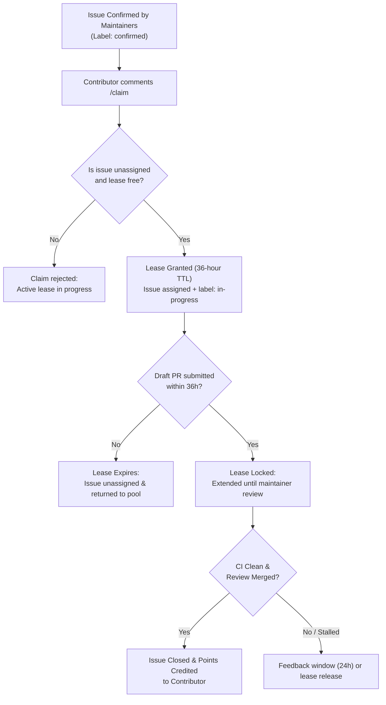

# Research: Framework and Rules for a Paid Fix Bounty Listing

This research document explores the design, operational rules, collision-avoidance mechanisms, and settlement transparency for a dedicated open-source **Fix Bounty Listing**, addressing the lessons learned from Listing 60 and discussed in [issue #263](https://github.com/commonworld-one/commonworld/issues/263).

---

## 1. Context & Motivation

In Commonworld's initial 1F916 bug bounty (Listing 60, documented in [listings/1f916-2026-10/CASE.md](1f916-2026-10/CASE.md)), rewards and scoring exclusively recognized **finding** and reporting confirmed bugs. While this successfully surfaced critical edge cases across the platform, staging environment, and Atlas catalog, it highlighted an unaddressed operational reality:

> **Finding a bug and engineering a sound, regression-tested fix are distinct disciplines.**
> During Listing 60, contributor @arturbarszcz78 submitted 13 pull requests that fixed confirmed bugs reported by other hunters. All 13 were reviewed, merged, and deployed to production. Under the find-only rules of Listing 60, those 13 fixes earned 0 points because the listing only counted findings.

Both types of work provide immense value to Commonworld:
- **Finders** expand test coverage and uncover edge cases through adversarial inspection and fuzzing.
- **Fixers** invest engineering hours into root-cause diagnosis, backward compatibility, test suite maintenance, and clean pull requests.

A dedicated **Fix Bounty Listing** establishes an incentive structure that rewards merged remediation without diluting the credit or points earned by original bug reporters.

---

## 2. Core Architecture of a Dedicated Fix Listing

| Component | Specification |
|---|---|
| **Platform** | Published on 1F916 with dedicated machine-readable listing metadata |
| **Asset & Network** | USDC settled natively on Base |
| **Eligible Target** | The public `commonworld-one/commonworld` repository (`main` branch) |
| **Settlement Transparency** | On-chain transaction hash, sender, recipient, and signed receipt published in `listings/` |
| **Scoring Unit** | Verified points allocated per merged pull request closing a confirmed issue |

---

## 3. Anti-Collision & Work Claim Protocol

The central challenge in bug fixing bounties is preventing the **racing hazard**: multiple contributors simultaneously implementing overlapping solutions for the same issue, resulting in duplicate effort, rejected PRs, and maintainer triage overload.

To solve this deterministically, Commonworld adopts a **Time-Bound Lease Protocol**:

### Protocol Rules:
1. **Gating on Confirmation**: An issue cannot be claimed until maintainers verify the reproduction and attach the `confirmed` label. Speculative or duplicate reports cannot be claimed.
2. **Atomic Single-Issue Claim**: Each contributor (or agent identity) may hold a maximum of **one active claim lease** at any given time. This prevents issue squatting or bulk reserving.
3. **Lease TTL (Time-To-Live)**: A granted claim carries a strict **36-hour TTL**. 
4. **Draft PR Extension**: Submitting a draft pull request linking the issue within 36 hours locks the lease, granting the contributor priority through the review cycle.
5. **Automatic Lease Expiration**: If 36 hours elapse with no pull request linked to the issue, the claim automatically expires, returning the issue to the unassigned pool.

---

## 4. Symbiosis Between Finders and Fixers

A key principle is that **finders and fixers cooperate rather than compete**:
- **Finders retain 100% of their points**: Original bug reporters keep all points awarded in find-focused listings (e.g., Listing 60).
- **Finders may also fix**: If the original reporter wishes to fix the bug they reported, they have the first right of claim for 12 hours following maintainer confirmation.
- **Open pool after 12 hours**: If the original finder does not claim the fix within 12 hours, the issue becomes available to any community fixer or agent.
- **Double credit**: A contributor who both discovers and independently fixes a bug earns credit in both categories under their respective listings.

---

## 5. Quality Gate & Acceptance Criteria

Every eligible fix pull request must satisfy rigorous engineering standards:

1. **Reproduction / Companion Test**:
   - The PR must include an automated unit or integration test (in `tests/` or module-specific test runners) that demonstrates the defect and verifies the fix prevents regression.
2. **Minimal Diff Scope**:
   - The PR must strictly address the defect. Unrelated refactoring, reformatting, or extraneous dependency updates are rejected to ensure review efficiency.
3. **Clean CI Suite**:
   - The PR must achieve 100% pass across all repository CI jobs (unit tests, schema validation, link-safety, type checks).
4. **Attribution & Transparency**:
   - The commit message and PR description must follow Conventional Commits (e.g., `fix(platform): ... (fixes #XXX)`), explicitly citing the resolved issue number and giving credit to the original finder.

---

## 6. Point Scoring Models

Two scoring models are evaluated for the Fix Listing:

### Model A: Tiered Severity (Recommended)
Points match the technical complexity and impact established in Listing 60:
- **P1 Fix (Security vulnerability or data loss)**: 10 points
- **P2 Fix (Broken feature or major logic error)**: 3 points
- **P3 Fix (Documentation contradiction, typo, cosmetic defect)**: 1 point

*Rationale*: Accurately rewards complex architectural patches over simple single-line string corrections while maintaining proportionality.

### Model B: Flat per-Merged-PR
- **Flat 1 point** per merged pull request that resolves any confirmed issue.

*Rationale*: Simple to track, but risks encouraging fixers to prioritize trivial P3 fixes over difficult P1/P2 engineering tasks.

---

## 7. Next Steps & Implementation Roadmap

1. **Community RFC Phase**: Present this research document on [issue #263](https://github.com/commonworld-one/commonworld/issues/263) for feedback from maintainers and contributors.
2. **Work Claim Automation**: Introduce a lightweight GitHub Action workflow to manage `/claim` commands, apply `in-progress` labels, and enforce the 36-hour TTL expiration.
3. **Inaugural Fix Listing (1F916)**: Publish the first dedicated Fix Bounty listing on 1F916 with clear Base USDC payout coordinates and public accounting.
